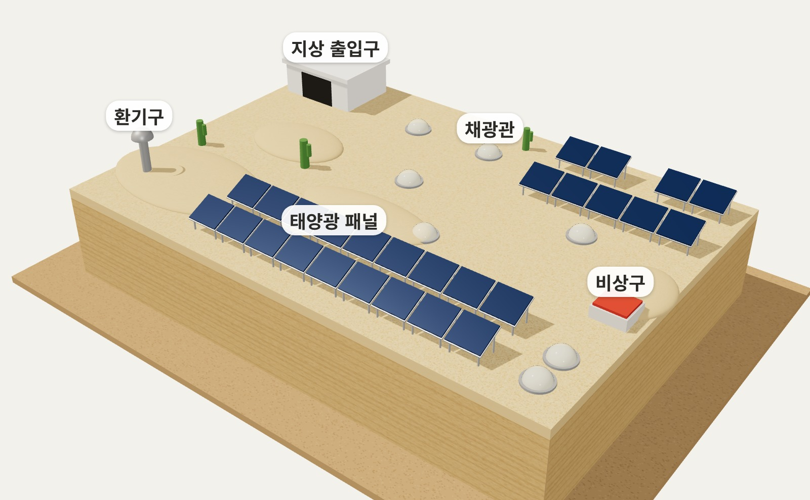
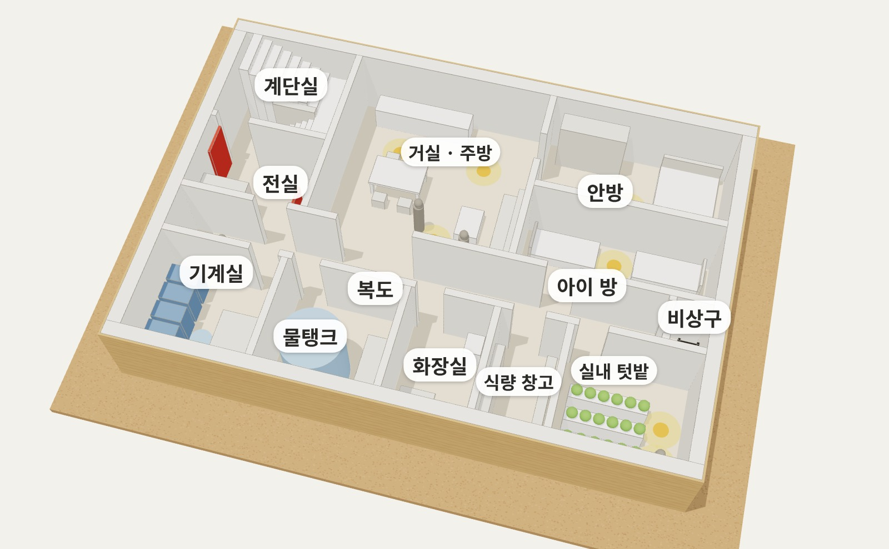
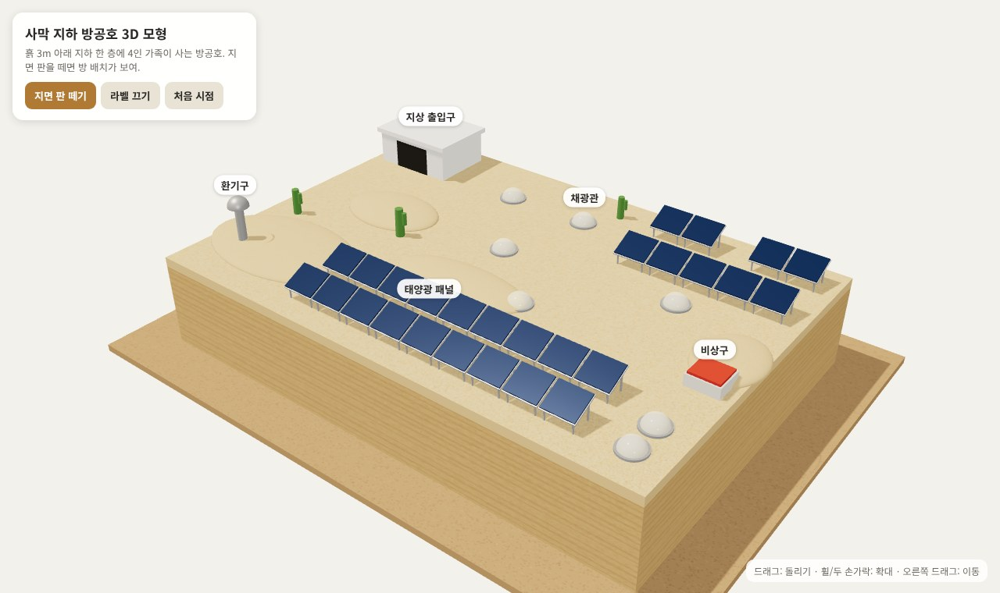

# 3dHouse · 사막 지하 방공호 3D 모형

기술 수행평가 "사막에 짓는 건물"로 설계한 방공호다. 흙 3m 아래 지하 한 층에 4인 가족이 살고, 지상에는 태양광 패널과 채광관, 출입구만 나와 있다.

| 지면 판을 덮은 모습 | 지면 판을 뗀 모습 |
|---|---|
|  |  |

## 3D로 돌려 보기

**GitHub에서 바로 보기 (STL)**
아래 파일을 누르면 GitHub이 3D 뷰어로 열어 준다. 마우스로 끌면 돌아가고, 휠로 확대할 수 있다. STL이라 색은 나오지 않는다.

- [지면 판을 덮은 모습 · bunker_closed.stl](model/bunker_closed.stl)
- [지면 판을 뗀 모습 · bunker_open.stl](model/bunker_open.stl)

**웹 뷰어 (색, 라벨, 지면 판 떼기 버튼)**
GitHub Pages를 켜면 https://mjayj9.github.io/3dHouse/ 에서 열린다. 버튼으로 지면 판을 떼었다 덮었다 할 수 있고, 방 이름 라벨도 함께 나온다. 태양광 패널, 채광관, 물탱크처럼 모형의 부분을 누르면 그 부분이 무슨 역할을 하는지 설명 카드가 뜬다.



GitHub Pages 켜는 법: 저장소 **Settings → Pages → Build and deployment**에서 Source를 *Deploy from a branch*로, Branch를 `main` / `/ (root)`로 두고 Save를 누른다. 1~2분 뒤 위 주소가 열린다.

**색이 들어간 3D 파일 (GLB)**
[model/bunker.glb](model/bunker.glb)는 색과 질감이 들어간 파일이다. 내려받아서 윈도우 "3D 뷰어"나 https://gltf-viewer.donmccurdy.com 같은 곳에서 열면 된다.

## 설계 요약

- 크기: 가로 16m × 세로 11m, 방 높이 2.6m, 위에 흙 3m를 덮는다.
- 지하층: 계단실 → 전실(방폭문 2개) → 복도를 따라 거실·주방, 안방, 아이 방, 기계실(배터리·우물·환기), 물탱크실, 화장실, 식량 창고, 실내 텃밭이 있다. 복도 끝에는 사다리로 올라가는 비상구가 있다.
- 지상: 태양광 패널 27장, 채광관 8개, 지상 출입구, 비상구 뚜껑, 환기구가 있다.
- 채광관은 지상의 돔으로 햇빛을 모아 방마다 내려보낸다. 웹 뷰어에서 지면 판을 떼면 바닥에 빛이 떨어지는 자리가 노랗게 보인다.

## 파일 구성

```
index.html          웹 뷰어 (three.js, CDN에서 불러옴)
js/bunker.js        모형을 만드는 코드 (단위: m)
js/info.js          부분을 눌렀을 때 나오는 설명
model/
  bunker_closed.stl 지면 판을 덮은 모형
  bunker_open.stl   지면 판을 뗀 모형 (지하층만)
  bunker.glb        색과 질감이 들어간 모형, 지면 판은 따로 떼어 낼 수 있는 부분으로 들어 있음
images/             렌더 사진
```

내 컴퓨터에서 `index.html`을 더블클릭하면 브라우저 보안 때문에 열리지 않을 수 있다. 그럴 때는 GitHub Pages 주소로 보거나, 폴더에서 `python -m http.server`를 실행한 뒤 http://localhost:8000 으로 연다.
